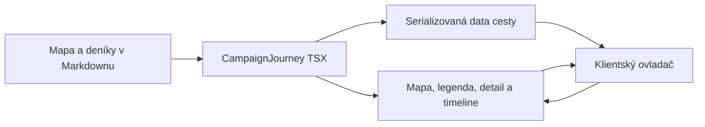
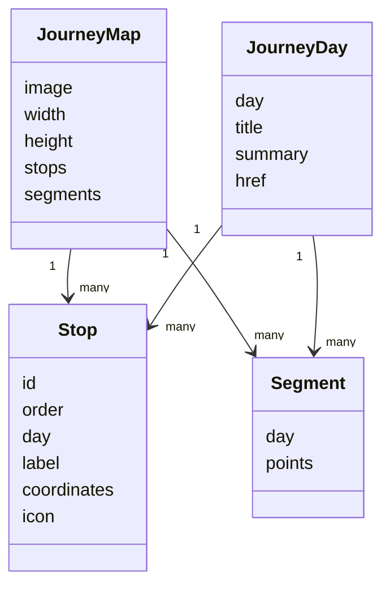

# Cesta družiny: návrh přestavby

## 1. Overview

Tento dokument popisuje cílovou přestavbu interaktivní mapy cesty družiny. Stávající mapa zobrazuje jeden bod na den a jednu souvislou trasu. Cílový stav odděluje herní den, zastávku a úsek cesty, aby mohl každý den obsahovat více bodů a samostatně stylované segmenty trasy.

## 2. Purpose

- Zachovat časovou osu a výběr dne.
- Zobrazovat očíslované ikonové zastávky podle legendy.
- Rozlišovat minulou, aktuální a budoucí část cesty.
- Zpřístupnit legendu, detail dne a markery bez překrývání mapy.

## 3. References

- Současná komponenta: `quartz/components/CampaignJourney.tsx`.
- Klientské ovládání mapy: `quartz/components/scripts/campaignJourney.inline.ts`.
- Styly komponenty: `quartz/components/styles/campaignJourney.scss`.
- Zdroj mapových dat: `content/map/cesta-druziny.md`.
- Deníkové zápisy: `content/denik/*.md`.

## 4. Technical Architecture

### System Context

Quartz při buildu načítá frontmatter mapy a deníkových záznamů. Komponenta vytvoří HTML, SVG segmenty a data pro klientský ovladač. V prohlížeči ovladač synchronizuje mapu, timeline, legendu a detail dne.

### Component View



### Infrastructure/Deployment View

Not evidenced in this repository. Komponenta je součástí statického Quartz webu a nevyžaduje novou službu ani databázi.

## 5. Service Capabilities

| Schopnost  | Cílové chování                                                                |
| ---------- | ----------------------------------------------------------------------------- |
| Výběr dne  | Aktivuje detail dne a zvýrazní odpovídající úseky.                            |
| Trasa      | Každý segment má přiřazený den a stav minulost, aktuální den nebo budoucnost. |
| Zastávky   | Ikonový marker odkazuje na den a lze jej vycentrovat.                         |
| Legenda    | Používá stejné ikony jako mapa a funguje jako seznam tlačítek.                |
| Detail dne | Je skládací; ve sbaleném stavu zachová označení vybraného dne.                |

## 6. Design

### Information Model



### Data Model

Mapová geometrie, ikony a legenda budou centrálně v `journeyMap` v `content/map/cesta-druziny.md`. Deníky zůstanou zdrojem názvu, shrnutí a odkazu konkrétního dne.

```yaml
journeyMap:
  stops:
    - id: anabelin-parez
      order: 1
      day: 3
      label: Anabelin pařez
      coordinates: [620, 910]
      icon: journey-icons/01-anabelin-parez.webp
  segments:
    - day: 3
      points: [[980, 810], [850, 860], [620, 910]]
```

Souřadnice budou vždy číselná dvojice `[x, y]` vzhledem k originálnímu obrázku `1600 × 1200`. Stávající textová souřadnice `journey.coordinates` se po migraci nepoužívá.

### API Model

Not evidenced in this repository. Mapa nemá síťové API; data jsou statická a serializovaná do stránky při buildu.

## 7. Security

Data pocházejí z lokálního Markdownu. Cesty k ikonám a odkazy budou před vykreslením validovány jako řetězce očekávaného tvaru. Interaktivní body budou tlačítka, nikoli HTML vkládané z obsahu zápisu.

## 8. Testing

- Jednotkové testy čistého modelu: validace zastávek, segmentů a duplikovaných ID.
- Jednotkové testy klasifikace segmentů pro minulost, aktuální den a budoucnost.
- Test navigace mezi nesouvislými dny a více zastávkami v jednom dni.
- Ruční kontrola markerů, legendy, sbaleného detailu, dotyku, klávesnice a SPA navigace.
- `npm run test`, `npm run check` a Quartz build po dokončení.

## 9. Known Limitations

- Geometrie zachycuje dosavadní cestu; nové zastávky a úseky se doplňují ručně do frontmatteru mapy.
- Konečné vizuální umístění zastávek je vhodné zkontrolovat přímo nad produkční mapou při dalších změnách trasy.

## 10. Architecture Decisions

1. Na desktopu je legenda v pravém panelu mimo mapu; na malých displejích se stane skládacím panelem.
2. Timeline je samostatný spodní řádek layoutu, nikoli absolutní overlay.
3. Kliknutí na položku legendy vždy vybere její den a vycentruje její marker.
4. Stav segmentu se neodlišuje jen barvou: aktuální je silnější, budoucí je méně výrazný a tečkovaný.
5. Více zastávek i více segmentů může patřit témuž dni.

## 11. Appendices

### Implementační checklist

- [x] Připravit 10 transparentních ikon z legendy.
- [x] Zavést typovaný model mapy, zastávek a segmentů.
- [x] Zapsat zastávky a počáteční segmenty do `cesta-druziny.md`.
- [x] Přepsat strukturu komponenty na mapu, pravý panel a timeline.
- [x] Renderovat samostatné SVG segmenty a ikonové markery.
- [x] Synchronizovat timeline, markery, legendu a detail dne.
- [x] Přidat skládací detail dne a seznam lokací.
- [x] Upravit desktopový a mobilní layout.
- [x] Odstranit stará `journey.coordinates` z deníků a aktualizovat nápovědu.
- [x] Přidat testy modelu a spustit úplnou validaci.

### Rozdělení práce

1. Datová část: zastávky, segmenty a jejich přiřazení ke dnům.
2. Assety: deset transparentních ikon v jednotném stylu.
3. Frontend: komponenta, ovladač mapy a styly.
4. QA: dostupnost, mobilní rozvržení a vizuální kontrola souřadnic.
